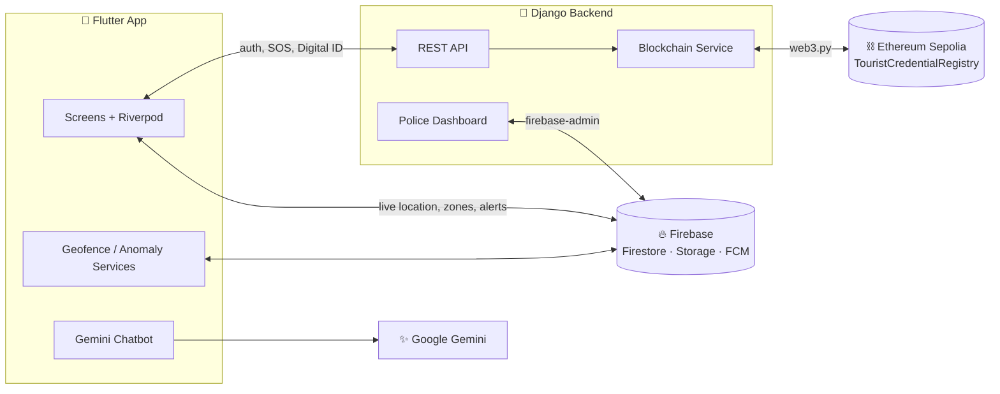

<div align="center">

# 🛡️ Pinnacle — Smart Tourist Safety System

**Smart Tourist Safety Monitoring & Incident Response System**
*Smart India Hackathon (SIH) project*

[](https://flutter.dev)
[](https://dart.dev)
[](https://www.djangoproject.com)
[](https://firebase.google.com)
[](https://sepolia.dev)
[](https://ai.google.dev)

A Flutter app for tourists and a Django web dashboard for police, sharing one live Firebase backend.
Features include **SOS alerts, geofenced danger zones, live location sharing, blockchain-verified digital IDs** and an **AI safety assistant**.

</div>

---

## 📑 Table of Contents

- [Key Features](#-key-features)
- [Architecture](#-architecture)
- [Tech Stack](#-tech-stack)
- [Project Structure](#-project-structure)
- [Getting Started](#-getting-started)
- [Environment Variables](#-environment-variables)
- [API Reference](#-api-reference)
- [Security Notes](#-security-notes)

---

## ✨ Key Features

### 📱 Tourist Mobile App

| Feature | Highlights |
|---|---|
| 🚨 **Emergency SOS** | One-tap SOS with live location · **SMS fallback when offline** · quick-dial emergency contacts · **Android home-screen widget** with an SOS button |
| 🗺️ **Geofencing** | Police-drawn unsafe zones synced live · ray-casting check for whether you're inside a zone · push notification + in-app banner, with a cooldown so alerts don't repeat |
| 📍 **Live Map** | Your position, unsafe zones and incidents on one map · demo mode with a fake location for presentations |
| 👨‍👩‍👧 **Location Sharing** | Share with **authorities** (Firestore) or **family** (shareable link) · **GPS anomaly watchdog** that alerts police if your location stops updating |
| 🪪 **Blockchain Digital ID** | Credential issued on Ethereum Sepolia · QR code to scan at airports, hotels and checkpoints · checked against the blockchain |
| 📝 **Incident Reporting** | Description, photo upload (Firebase Storage) and location · police update the status |
| 🔔 **Police Alerts** | Live Firestore listener → local notification + banner · alerts feed |
| 🤖 **AI Safety Chatbot** | Gemini Flash with streamed replies · instructions editable from the dashboard |
| 🏠 **Home Dashboard** | Safety status, weather and air quality, quick actions |
| 🧭 **Onboarding** | 7 steps: phone OTP → identity → travel → emergency contacts → stay → medical → consent · resumes where you left off |
| 🌐 **Multilingual** | English, हिन्दी, Español, Français, العربية, 中文 |

### 🖥️ Police Dashboard (Django)

| Module | Capabilities |
|---|---|
| **Live Map** | Live tourist locations · draw, edit and delete unsafe zones |
| **SOS Console** | Live SOS feed · acknowledge · update status · view tourist details |
| **Alerts** | Create, turn on/off and delete broadcast alerts |
| **Incidents** | Review tourist reports and update their status |
| **Anomalies** | Lost-GPS warnings with acknowledgement |
| **AI Config** | Edit the chatbot's instructions |
| **Tourist Profiles** | Look up a tourist by user ID or email |

---

## 🏗️ Architecture



---

## 🧰 Tech Stack

| Layer | Technologies |
|---|---|
| **Mobile** | Flutter, Riverpod, go_router, flutter_map, geolocator, flutter_local_notifications, qr_flutter, flutter_secure_storage |
| **Backend** | Django 6, Django REST Framework, django-cors-headers, python-decouple |
| **Cloud** | Firebase Firestore, Storage, Cloud Messaging (firebase-admin) |
| **Blockchain** | Solidity smart contract on Ethereum Sepolia, web3.py |
| **AI** | Google Gemini (`google_generative_ai`) |
| **Deployment** | Vercel (backend) |

---

## 📂 Project Structure

```
Tourist_Safety_App_SIH_Pinnacle/
├── lib/                         # Flutter app
│   ├── core/                    # Router, theme, shared widgets
│   ├── l10n/                    # Translations (6 languages)
│   ├── providers/               # Riverpod state (SOS, location, weather, ID…)
│   ├── screens/                 # UI screens (+ onboarding/ steps)
│   ├── services/                # Firestore, geofence, anomaly, Gemini, API…
│   └── widgets/                 # Chatbot overlay
├── backend/PinnacleBackend/     # Django project
│   ├── backend/                 # REST API, auth, blockchain_service.py
│   ├── dashboard/               # Police dashboard (templates, static, views)
│   └── requirements.txt
├── contracts/                   # TouristCredentialRegistry.sol
└── android/ ios/ web/ …         # Platform folders
```

---

## 🚀 Getting Started

### Prerequisites
- Flutter SDK **≥ 3.7.2**
- Python **3.10+**
- A Firebase project (Firestore, Storage, Messaging enabled)
- *(Optional)* Google Maps API key, Gemini API key, Sepolia RPC URL

### 1️⃣ Backend

```bash
cd backend/PinnacleBackend
python -m venv .venv && source .venv/bin/activate   # Windows: .venv\Scripts\activate
pip install -r requirements.txt

cp .env.example .env              # then fill in values (see below)
# Place your Firebase service account key at:
#   backend/PinnacleBackend/firebase-service-account.json

python manage.py migrate
python manage.py createsuperuser  # police dashboard login
python manage.py runserver        # http://127.0.0.1:8000
```

The police dashboard is at **`/dashboard/`**.

### 2️⃣ Mobile App

```bash
# From the project root
echo "GEMINI_API_KEY=your_key" > .env
flutter pub get
flutter gen-l10n
flutter run                       # use `flutter devices` to choose a target
```

> 💡 **Demo mode:** on the login or registration screen, tap **"Continue as Demo User"** to try the app without signing up.

---

## 🔐 Environment Variables

**Backend — `backend/PinnacleBackend/.env`**

| Variable | Required | Description |
|---|:---:|---|
| `SECRET_KEY` | ✅ | Django secret key |
| `DEBUG` | ✅ | `True` / `False` |
| `ALLOWED_HOSTS` | ➖ | Comma-separated hosts for production |
| `GOOGLE_MAPS_API_KEY` | ➖ | Sent to the app via `/api/config/maps-key/` |
| `SEPOLIA_RPC_URL` | ➖ | Ethereum RPC endpoint |
| `ISSUER_PRIVATE_KEY` | ➖ | Wallet key that issues credentials |
| `CONTRACT_ADDRESS` | ➖ | Deployed `TouristCredentialRegistry` address |

> ℹ️ If any of the three blockchain variables is missing, the backend falls back to **offline mode** and Digital IDs still work locally.

**Flutter — `.env` (project root)**

| Variable | Description |
|---|---|
| `GEMINI_API_KEY` | API key for the AI chatbot |

**Android — `android/gradle.properties`**

| Variable | Description |
|---|---|
| `GOOGLE_MAPS_API_KEY` | Maps key used at build time |

---

## 📡 API Reference

<details>
<summary><b>Tourist API</b> (<code>/api/…</code>)</summary>

| Method | Endpoint | Purpose |
|---|---|---|
| POST | `/api/auth/register/` | Register |
| POST | `/api/auth/signin/` | Sign in |
| POST | `/api/auth/logout/` | Log out |
| GET | `/api/auth/me/` | Current user |
| POST | `/api/onboarding/` | Save onboarding data |
| POST | `/api/sos/` | Trigger SOS |
| GET | `/api/config/maps-key/` | Get Maps API key |
| POST | `/api/digital-id/issue/` | Issue Digital ID |
| GET | `/api/digital-id/me/` | Get my Digital ID |
| GET | `/api/digital-id/verify/<credential_id>/` | Verify a credential |

</details>

<details>
<summary><b>Dashboard API</b> (<code>/dashboard/api/…</code>)</summary>

| Endpoint | Purpose |
|---|---|
| `zones/create/` · `zones/<id>/update/` · `zones/<id>/delete/` | Manage unsafe zones |
| `alerts/create/` · `alerts/<id>/activate/` · `deactivate/` · `delete/` | Manage alerts |
| `incidents/<id>/status/` | Update incident status |
| `sos/poll/` · `sos/<id>/acknowledge/` · `sos/<id>/status/` | SOS handling |
| `anomalies/` · `anomalies/<session_id>/acknowledge/` | GPS anomalies |
| `ai-config/save/` | Save chatbot instructions |
| `tourists/<user_id>/profile/` · `tourists/profile-by-email/<email>/` | Tourist lookup |

</details>

---

## 🔒 Security Notes

These files are listed in `.gitignore` and must **never be committed**:

- `backend/PinnacleBackend/.env`
- `backend/PinnacleBackend/firebase-service-account.json`
- `android/gradle.properties`
- `.env` (Flutter)
- `*.sqlite3` (the local database, which holds user data)

Restrict your Google Maps key to your Android package name and iOS bundle ID.

---

<div align="center">

Made with ❤️ by **Team Pinnacle** for Smart India Hackathon

</div>
